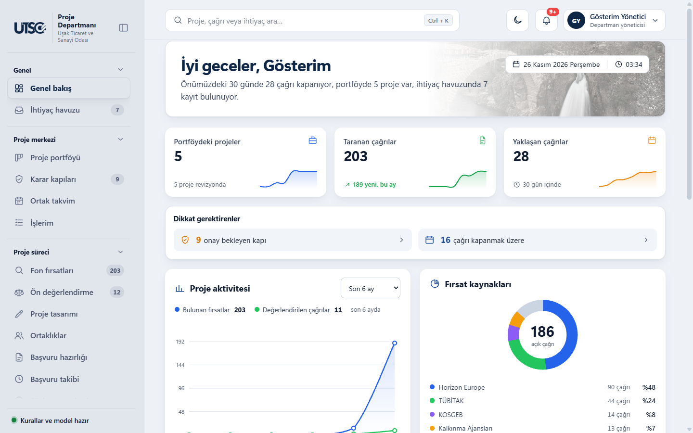
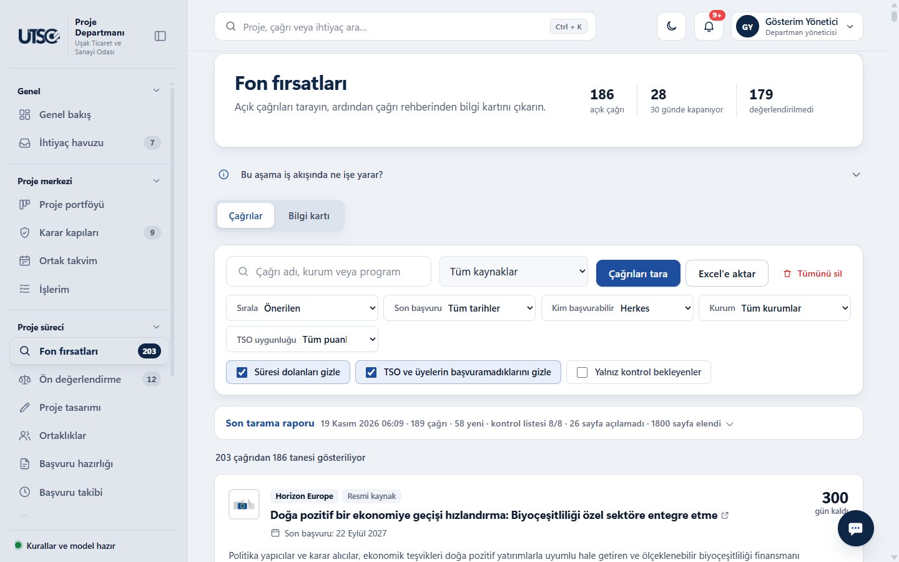

# TSO AI | Kurumsal Yapay Zeka Asistanı

Ticaret ve Sanayi Odaları için geliştirilen, proje yönetimi, fon fırsatları, belge analizi ve bütçe kontrol süreçlerini yapay zeka ile destekleyen kurumsal AI agent sistemi.

## Hakkında

TSO AI Agent, Ticaret ve Sanayi Odalarının proje yönetim süreçlerini yapay zeka ile desteklemek amacıyla geliştirilen kurumsal bir platformdur. Fon ve hibe fırsatlarının analizi, başvuru uygunluğunun değerlendirilmesi, proje ortaklarının araştırılması ve belgelerdeki eksik veya tutarsız bilgilerin tespit edilmesini hedefler. Bütçe kontrolü, risk takibi, raporlama ve kurumsal bilgi yönetimini bir araya getirerek proje departmanlarının daha sistematik ve verimli çalışmasını amaçlar.

## Ekran görüntüleri

| Fon fırsatları | Ön değerlendirme |
|---|---|
|  |  |

## Teknolojiler

Python · Ollama · Qwen · LangGraph · RAG · FastAPI

---

> Bu depo yalnızca projenin tanıtımı içindir; kaynak kodu paylaşılmamaktadır.
