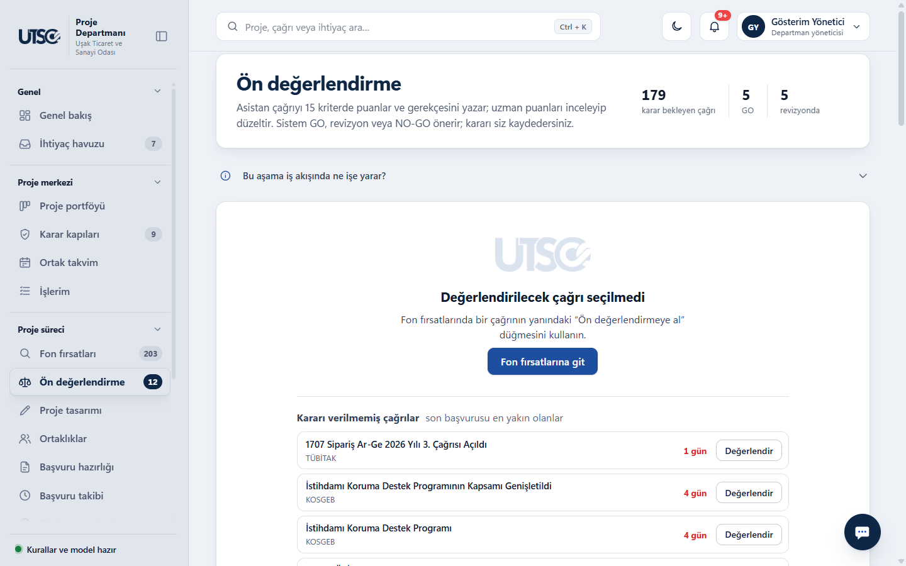

<div align="center">

# 🏛️ TSO AI

### Kurumsal Yapay Zeka Asistanı

Ticaret ve Sanayi Odaları için proje yönetimi, fon fırsatları, belge analizi ve bütçe kontrolünü yapay zeka ile destekleyen kurumsal AI agent sistemi


<br>


</div>

---

## 📖 Hakkında

TSO AI Agent, Ticaret ve Sanayi Odalarının proje yönetim süreçlerini yapay zeka ile desteklemek amacıyla geliştirilen kurumsal bir platformdur. Fon ve hibe fırsatlarının analizi, başvuru uygunluğunun değerlendirilmesi, proje ortaklarının araştırılması ve belgelerdeki eksik veya tutarsız bilgilerin tespit edilmesini hedefler. Bütçe kontrolü, risk takibi, raporlama ve kurumsal bilgi yönetimini bir araya getirerek proje departmanlarının daha sistematik ve verimli çalışmasını amaçlar.

> **Temel ilke:** AI analiz eder → proje uzmanı değerlendirir → yetkili onaylar → sistem kaydeder.
> Yapay zeka hiçbir kararı tek başına vermez.

## 🔄 İş akışı

Bir projenin ilk ihtiyaçtan kapanışa kadar tüm yolculuğu tek ekranda izlenir:

```
 İhtiyaç havuzu ─► Fon fırsatları ─► Ön değerlendirme ─► Karar kapıları (GO / NO-GO)
                                                                    │
 Kurumsal hafıza ◄─ Kapanış ◄─ Uygulama ◄─ Başvuru ◄─ Ortaklıklar ◄─ Proje tasarımı
```

## ✨ Modüller

<table>
<tr>
<td width="50%" valign="top">

### 🔍 Fon fırsatı tarama
TÜBİTAK, KOSGEB, kalkınma ajansları, bakanlıklar, TOBB, Erasmus+, Horizon Europe ve Interreg gibi 12 kaynağın açık çağrıları otomatik taranır, son başvuru tarihine ve uygunluğa göre sıralanır.

</td>
<td width="50%" valign="top">

### 🗂️ Çağrı bilgi kartı
Çağrı rehberleri ve PDF belgeler okunur; bütçe, destek oranı, süre, kimlerin başvurabileceği gibi alanlar yapay zeka ile tek bir kartta özetlenir.

</td>
</tr>
<tr>
<td width="50%" valign="top">

### ⚖️ GO / NO-GO ön değerlendirme
Her çağrı 15 kritere göre puanlanır ve gerekçesiyle birlikte GO, revizyon ya da NO-GO önerisi sunulur. Son kararı yetkili verir.

</td>
<td width="50%" valign="top">

### 💬 Sohbet asistanı
Kayıtlara bakarak soruları yanıtlayan AI agent. Yalnızca okuma yetkisiyle çalışır, kayıtta olmayan sayı veya tarih uydurmaz.

</td>
</tr>
<tr>
<td width="50%" valign="top">

### 📊 Proje portföyü ve takvim
Portföydeki projeler, onay bekleyen karar kapıları ve yaklaşan son başvuru tarihleri ortak bir takvimde toplanır.

</td>
<td width="50%" valign="top">

### 🧠 Kurumsal hafıza
Tamamlanan projeler, NO-GO arşivi ve performans göstergeleri kurumun bilgi birikimine dönüşür.

</td>
</tr>
</table>

## 🖼️ Ekran görüntüleri

<table>
<tr>
<td width="50%"></td>
<td width="50%"></td>
</tr>
<tr>
<td align="center"><sub><b>Fon fırsatları</b> · açık çağrılar, filtreler ve tarama raporu</sub></td>
<td align="center"><sub><b>Ön değerlendirme</b> · karar bekleyen çağrılar</sub></td>
</tr>
</table>

## 🛠️ Teknik yapı

| Katman | Kullanılan |
|---|---|
| Arka uç | Python, FastAPI |
| Yapay zeka | Ollama üzerinde yerel Qwen modeli, araç çağırabilen AI agent |
| Bilgi erişimi | RAG: embedding + BM25 hibrit arama |
| Belge işleme | PDF ve web sayfalarından temiz metin çıkarımı |
| Veri | SQLite |
| Güvenlik | Rol tabanlı yetki (yönetici / üye), sunucu tarafında denetim |

**Neden yerel model?** Kurumun belgeleri ve projeleri dışarıdaki bir servise gönderilmez; model kurumun kendi bilgisayarında çalışır. İnternet yalnızca fon çağrılarını taramak için gerekir.

---

<div align="center">

🔒 Bu depo yalnızca projenin tanıtımı içindir; kaynak kodu paylaşılmamaktadır.

**[tetik.dev](https://tetik.dev/projects.html)** · Muhammed Ali Tetik

</div>
